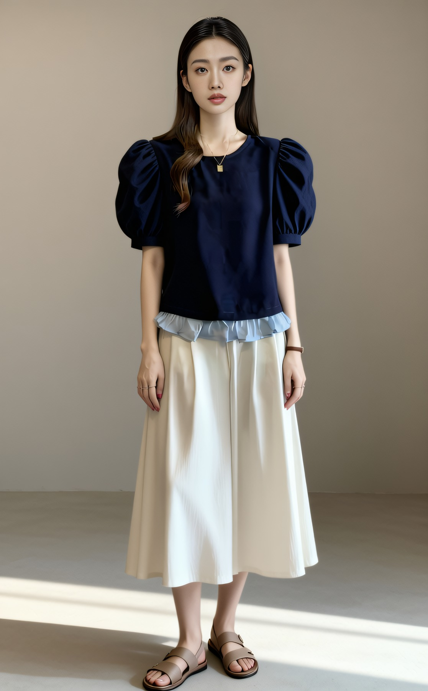
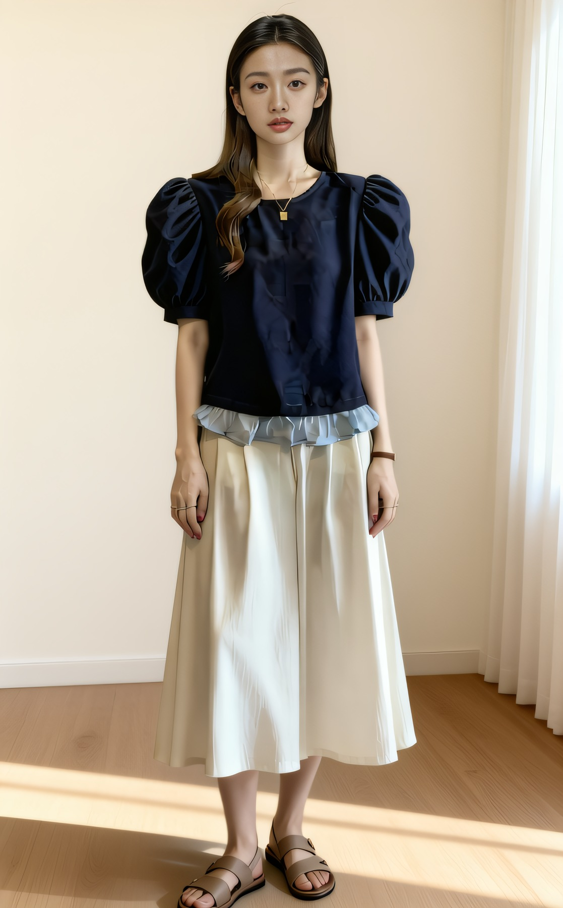

# AIGC 电商视觉生产管线(女装商拍)

> 从一个模糊想法,到一条能稳定批产、能用数据裁决技术路线、敢把失败实验如实归档的完整管线。
> 全部在单张消费级显卡(RTX 4070 Ti SUPER 16GB)上完成。


## 这个项目解决什么问题

女装电商的模特实拍:一款服装几百到上千元、周期好几天、改一处重拍一次。这个项目验证并跑通了一件事——**用开源模型在端侧把商拍做到"可交付"质量**:

| 环节 | 能力 | 交付规格 |
|---|---|---|
| 智能换装 | 人脸参考 + 服装参考多图指令编辑 | 2600×3466px(4x 超分) |
| 全场景重绘 | 影棚 → 街拍 / 室内,人物场景一体生成 | 同上 |
| 姿态裂变 | 同一模特 × 多姿态(真实姿态照做肢体+身份锚) | 六宫格/单张大图 |
| 光板净化 | 服装上的文字/印花擦除,双路线选型 | 电商上架光板图 |
| AI 视频 | 图生视频、首尾帧换装转场、加速路线 | 704×1280@24fps,10 条成片 + 32.8s 混剪 |

## 结果数字

- **选型靠对照实验**:SDXL 遮罩重绘 vs 指令编辑同输入对比,身份一致性 **CLIP-I 0.79 → 0.82**,据此确定 Qwen-Image-Edit-2511 为主力管线
- **批产稳定**:ComfyUI API 调度(队列/上传/轮询/断点重跑)+ 冻结看门狗自动重启,单卡 40 步 **6 分钟/张**无人值守过夜
- **视频三路线实测**:Wan2.2 TI2V 5B(20 步 203s/条)、Wan2.1 FLF2V 14B 首尾帧(5601s/条,一条视频内完成换装转场)、A14B + Lightning 4 步蒸馏(717s/81 帧)
- **质量可检查**:自建五维审片体系(时序/身份/服装/动作/画质,0–2 分制,≥8 分入册)+ DWPose 手部 21 点关键点质检
- **两次判负实验如实归档**(见下)

## 技术路线怎么定的(方法论)

1. **路线不确定 → 自己搭对照实验**:不站队文章,同输入跑两条管线,用量化指标裁决;
2. **报错往下挖一层**:第三方转存权重维度 3072 ≠ 官方 3584,读 safetensors 文件头定位后换官方权重;
3. **不稳定的先定位根因再治**:批产随机冻结 ≠ 显存不足,实为 RAM 页交换拖死进程 → 看门狗自动重启 + 断点重跑,而不是盲目加显存;
4. **失败也是产出**:判负实验写进文档,划清模型能力边界,避免下次再踩。

### 两次判负实验(如实记录)

- **TI2V-5B 纯文生视频跑题**:两个 prompt 生成内容完全不符 → 结论:该模型文本仅驱动运动,内容必须由图像条件提供;
- **14B 采样 Errno 22**:三次复现后用对照实验定位真因——PowerShell `Start-Process` 的句柄继承破坏了权重文件 mmap,改用 `subprocess.Popen` 启动即恢复(并非社区猜测的显存模式问题)。

## 目录导航

```
├── docs/
│   ├── 精选图片包/     # 换装/场景/姿态/净化 输出成品(输入素材图不在仓库内)
│   ├── 精选视频包/     # 10 条终选成片 + reel 混剪(14–24 规范命名)
│   ├── 审片记录_v13.md      # 五维审片逐条打分记录
│   ├── 视频质量标准_v13.md  # 审片标准定义
│   ├── 迭代总结_v10/v11/v13 # 每轮迭代:问题→方案→结果
│   ├── 调研_v10/v11.md      # 技术调研(含引用来源)
│   └── 评审记录_*           # 逐轮评审与改进闭环
├── scripts/            # 全部迭代脚本:v2→v13 生成/评测/打包/看门狗(comfy_api.py)
└── workflows/          # ComfyUI API 工作流 JSON
```

核心脚本索引:`comfy_api.py`(API 调度+看门狗)、`eval_metrics*.py`(CLIP-T/CLIP-I 评测)、`v12_codeformer.py`(人脸修复链)、`v13_video.py`(视频三路线)、`v13_html.py`/`render_pdf.py`(作品集生成)。

## 部分成果示例





更多见 `docs/精选视频包/`(含首尾帧换装转场、加速路线对照样片)。

## 声明

- 本仓库所有图片与视频均为 **AI 生成产物**,模特形象为 AI 生成虚拟形象,不涉及真人;
- 版权服装参考素材图**未包含**在仓库内,仅保留生成结果用于展示管线能力;
- 仓库中的脚本为本地单机迭代产物,路径已做整理,按 README 记录的思路可复现,不承诺开箱即用。
